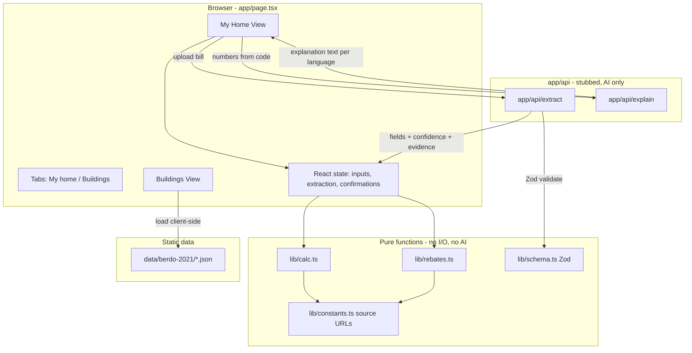
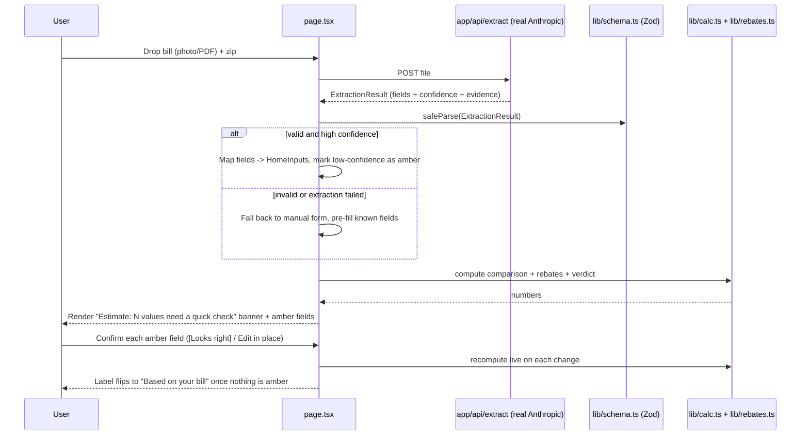

# Design Document: HeatSwitch

## Overview

HeatSwitch is a single-page Next.js (App Router) application that gives Boston households an honest answer to one question: should I switch my heating to a heat pump? A user uploads a gas, electric, or oil bill (or clicks a "Try demo home" button), and the app shows current heating cost versus heat pump cost, breakeven COP, whether the Massachusetts seasonal heat pump electric rate helps, Mass Save rebates, net install cost, payback, and a plain-English verdict. Renters and landlords get a tailored path, and a Buildings tab ranks Boston multifamily buildings by heat pump opportunity from the City of Boston BERDO 2021 dataset.

The architecture enforces one hard rule from the product: **the LLM never computes a number.** All arithmetic lives in pure, deterministic TypeScript functions (`lib/calc.ts`, `lib/rebates.ts`) that are property-tested with fast-check. The LLM is confined to two narrow jobs behind API routes that make **real Anthropic SDK calls (model `claude-sonnet-5-5`)** in the later build-order steps: (1) extracting fields from a bill image/PDF into Zod-validated JSON with a per-field confidence and the exact evidence text, and (2) writing human-readable explanation text from numbers the code hands it. The scaffold step may create placeholder routes, but tasks 6 (extraction) and 7 (explanation) implement the real calls, reading `ANTHROPIC_API_KEY` from `process.env` server-side only (never printed or committed). If extraction fails or is low-confidence, the UI falls back to a manual form with known fields pre-filled, and any uncertain value is shown in amber for inline confirmation before the verdict is trusted.

This document combines a High-Level Design (architecture, sequence flows, components, data models) with a Low-Level Design (TypeScript interfaces, function signatures with pre/postconditions, algorithmic pseudocode, example usage, and correctness properties). The sections conclude with the build order that the tasks will follow.

## Architecture



Key architectural constraints:

- **One page, two tabs.** `app/page.tsx` renders a shadcn `Tabs` with "My home" and "Buildings (landlords & city)". No routing, no auth, no database.
- **Pure logic is isolated.** `lib/calc.ts` and `lib/rebates.ts` import only from `lib/constants.ts` and standard types. They do no I/O and call no network. This makes them trivially testable and keeps all math out of the AI.
- **AI is real but boxed.** `app/api/extract` and `app/api/explain` make real Anthropic SDK calls with model `claude-sonnet-5-5` (implemented in tasks 6 and 7; the scaffold may leave placeholders). Extraction output always passes through a Zod schema. Explanation input is always numbers already computed by `lib/calc.ts`/`lib/rebates.ts`. The key is read from `process.env.ANTHROPIC_API_KEY` server-side only.
- **Static data, client-side.** BERDO 2021 rows live under `data/berdo-2021/` as a static JSON file loaded in the browser for the Buildings tab.

### Repository / file structure

```text
app/
  page.tsx                 # single page, two tabs
  layout.tsx               # Inter font, light mode
  api/
    extract/route.ts       # real Anthropic (claude-sonnet-5-5): bill -> ExtractionResult (Zod-validated)
    explain/route.ts       # real Anthropic (claude-sonnet-5-5): numbers -> explanation text per language
components/
  my-home/
    upload-card.tsx
    verdict-card.tsx
    cost-chart-card.tsx
    your-numbers-card.tsx
    assumptions-card.tsx
    rebates-card.tsx
    next-step-row.tsx
    how-we-calculate.tsx
  buildings/
    buildings-table.tsx
    zip-picker.tsx
  shared/
    source-link.tsx         # grey source link/tooltip under every number
    confirm-field.tsx       # amber outline + evidence + [Looks right] [Edit]
lib/
  constants.ts              # every constant has a source URL comment
  calc.ts                   # pure heating/heat-pump cost math
  rebates.ts                # pure Mass Save rebate + payback math
  schema.ts                 # Zod schemas for extraction + inputs
data/
  berdo-2021/
    buildings.json          # static BERDO 2021 dataset
docs/
  design/reference.png      # existing visual reference (keep)
README.md                   # existing (keep)
```

## Sequence Diagrams

### Flow 1: Try demo home (fastest path, no AI, but demoes the amber flow)

Demo homes load **cached extraction-style data** — the same `ExtractionResult` shape the AI route would return, with a value, confidence, and exact evidence text per field. This lets the inline confirmation flow be demonstrated with no AI call. The **gas demo home carries exactly one low-confidence field** so a single amber confirmation appears.

```mermaid
sequenceDiagram
    participant U as User
    participant P as page.tsx
    participant S as lib/schema.ts (Zod)
    participant C as lib/calc.ts
    participant R as lib/rebates.ts

    U->>P: Click "Try: Gas home"
    P->>P: Load cached ExtractionResult (fields + confidence + evidence)
    P->>S: safeParse(cached ExtractionResult)
    S-->>P: valid; map to HomeInputs, mark the one low-confidence field amber
    P->>C: computeComparison(inputs, assumptions)
    C-->>P: CostComparison (current vs heat pump, breakeven COP)
    P->>R: computeRebates(inputs, assumptions)
    R-->>P: RebateResult (tier, amount, net cost, payback)
    P->>C: decideVerdict(comparison, rebates, inputs, now)
    C-->>P: Verdict (label, actBeforeDec31)
    P-->>U: Render verdict + chart + numbers; "Estimate: 1 value needs a quick check" (gas demo)
    U->>P: Confirm the amber field ([Looks right])
    P-->>U: Label flips to "Based on your bill"; recompute live
```

### Flow 2: Upload a bill (AI extraction, then pure math)



### Flow 3: Explanation text (numbers in, prose out)

```mermaid
sequenceDiagram
    participant P as page.tsx
    participant X as app/api/explain (real Anthropic)

    P->>P: Collect computed numbers (never ask AI to compute)
    P->>X: POST {verdict, numbers, language}
    X-->>P: explanation string in requested language
    P->>P: Render explanation; numbers in UI still come from code
```

## Components and Interfaces

### Component: UploadCard

**Purpose**: Entry point. Drop zone for a bill photo/PDF, a zip code field, a "Heat included in my rent" toggle, and three demo buttons (Oil / Gas / Baseboard home). Each demo button loads a **cached `ExtractionResult`** (value + confidence + evidence per field), not bare inputs, so demos exercise the same Zod + confirmation path as a real upload. The **gas demo** includes exactly one low-confidence field to showcase the amber confirmation flow without any AI call.

**Interface**:
```typescript
interface UploadCardProps {
  zip: string;
  heatIncludedInRent: boolean;
  onZipChange: (zip: string) => void;
  onRentToggle: (included: boolean) => void;
  onBillSelected: (file: File) => void;        // triggers POST /api/extract (real AI, task 6)
  onTryDemo: (demo: DemoHome) => void;          // "oil" | "gas" | "baseboard"
}

type DemoHome = "oil" | "gas" | "baseboard";

/** Each demo button maps to a cached ExtractionResult (fields + confidence + evidence).
 *  The "gas" demo contains exactly one field with confidence < CONFIDENCE_THRESHOLD. */
```

**Responsibilities**:
- Accept a dropped/selected file and hand it up for extraction.
- Capture zip (drives Boston vs non-Boston next step and equity-zone informational notice).
- Load the demo's cached `ExtractionResult` on button click (no AI call); feed it through the same Zod parse + amber-confirmation path as a real upload.

### Component: VerdictCard

**Purpose**: The headline answer. Shows the verdict label, an "Act before Dec 31" badge when relevant, the big annual number, the AI explanation, and a language dropdown.

**Interface**:
```typescript
interface VerdictCardProps {
  verdict: Verdict;                 // label + actBeforeDec31
  annualDeltaDollars: number;       // + = savings (emerald), - = extra cost (amber)
  explanation: string | null;       // from /api/explain; null => Skeleton
  language: Language;
  isEstimate: boolean;              // true while any field is amber
  onLanguageChange: (lang: Language) => void;
}
```

**Responsibilities**:
- Render verdict label text-4xl font-semibold; savings emerald-600, extra cost amber-600, never red.
- Show "Estimate" vs "Based on your bill" per `isEstimate`.
- Show Skeleton while explanation loads.

### Component: CostChartCard

**Purpose**: Two-bar comparison (current heating cost vs heat pump cost) plus a breakeven COP readout, using Recharts.

**Interface**:
```typescript
interface CostChartCardProps {
  currentAnnualCost: number;
  heatPumpAnnualCost: number;
  breakevenCOP: number;
}
```

### Component: YourNumbersCard

**Purpose**: The editable truth table. Each field shows its value, the bill text it came from beneath it, and an amber outline when unconfirmed. Includes the heating-type chip.

**Interface**:
```typescript
interface YourNumbersCardProps {
  fields: EditableField[];          // one per extracted/entered value
  heatingType: HeatingType;         // chip: "Looks like gas heat. [Yes] [Change]"
  onFieldConfirm: (key: FieldKey) => void;
  onFieldEdit: (key: FieldKey, value: number) => void;
  onHeatingTypeChange: (type: HeatingType) => void;
}
```

**Responsibilities**:
- Render `ConfirmField` for each value: amber outline + evidence text + [Looks right] [Edit].
- Edit in place (no modal, no new tab); recompute live on change.

### Component: AssumptionsCard

**Purpose**: Sliders for adjustable assumptions (heat pump COP, electricity price, fuel price) and a switch for the MA seasonal heat pump rate.

**Interface**:
```typescript
interface AssumptionsCardProps {
  assumptions: Assumptions;
  onChange: (next: Assumptions) => void;        // recompute live
}
```

### Component: RebatesCard

**Purpose**: Rebate tier, rebate amount, net install cost, payback, the requirements checklist (Mass Save assessment, weatherization, network installer, R-32/R-454B refrigerant), the "install by Dec 31, 2026" note, and the renter/landlord path when the rent toggle is on.

**Interface**:
```typescript
interface RebatesCardProps {
  rebates: RebateResult;            // includes the selected tier
  deadlineNote: string;             // REBATE_DEADLINE_NOTE
  heatIncludedInRent: boolean;
  isRenter: boolean;
  onShowLandlordPath: () => void;
}
```

### Component: NextStepRow

**Purpose**: Calls to action. Boston Energy Saver consultation for Boston zips, Mass Save Home Energy Assessment elsewhere, plus an enhanced-incentive notice for equity zips.

**Interface**:
```typescript
interface NextStepRowProps {
  zip: string;
  isBostonZip: boolean;
  isEquityZip: boolean;   // drives an informational enhanced-incentive notice ONLY; never the rebate amount
}
```

### Component: BuildingsTable

**Purpose**: Zip picker plus a ranked table of Boston multifamily buildings by heat pump opportunity, sourced from BERDO 2021.

**Interface**:
```typescript
interface BuildingsTableProps {
  buildings: BerdoBuilding[];
  selectedZip: string | null;
  onZipChange: (zip: string | null) => void;
}
```

**Responsibilities**:
- Load the static dataset client-side, filter by zip, rank by opportunity score.
- Render type, year built, area, energy use, emissions, electric/gas share, opportunity label.

### Shared Component: SourceLink

**Purpose**: A small grey source link/tooltip rendered beneath every number per the design rule.

```typescript
interface SourceLinkProps {
  label: string;      // e.g. "Mass Save, 2024"
  href?: string;      // source URL
}
```

### Shared Component: ConfirmField

**Purpose**: Inline confirmation primitive. Shows best-guess value immediately; amber outline when unconfirmed; evidence text; [Looks right] [Edit] with edit-in-place.

```typescript
interface ConfirmFieldProps {
  value: number;
  unit: string;
  evidence?: string;          // exact bill text this came from
  confirmed: boolean;         // false => amber outline
  onConfirm: () => void;
  onEdit: (value: number) => void;
}
```

## Data Models

### Model: HomeInputs

The normalized inputs that drive all calculations, regardless of source (bill, oil form, or demo).

```typescript
type HeatingType = "gas" | "oil" | "electric-resistance" | "propane";

type Language =
  | "en"   // English
  | "es"   // Spanish
  | "cv"   // Cape Verdean Creole
  | "zh"   // Chinese
  | "ht"   // Haitian Creole
  | "vi";  // Vietnamese

type Utility = "eversource" | "national-grid" | "unitil";

interface HomeInputs {
  heatingType: HeatingType;
  /** Annual heating energy use expressed in the fuel's native unit. */
  annualFuelUse: number;          // therms (gas), gallons (oil/propane), or kWh (electric)
  fuelUnitPrice: number;          // $/therm, $/gallon, or $/kWh
  zip: string;
  utility: Utility;               // drives the seasonal heat pump rate discount ($/kWh)
  heatIncludedInRent: boolean;
  householdSize: number;          // used to pick the Mass Save rebate tier
  annualIncome?: number;          // optional; when absent, default to the Standard tier
}
```

**Validation Rules**:
- `annualFuelUse > 0`, `fuelUnitPrice > 0`.
- `zip` matches `/^\d{5}$/`.
- `heatingType` is one of the enum values; `utility` is one of the `Utility` enum values.
- `householdSize >= 1` (integer); `annualIncome`, when present, is `>= 0`.

### Model: Assumptions

User-adjustable knobs with defaults from `lib/constants.ts`.

```typescript
interface Assumptions {
  heatPumpCOP: number;            // seasonal coefficient of performance, default from constants
  electricityPrice: number;       // $/kWh
  seasonalHeatPumpRate: boolean;  // MA seasonal heat pump electric rate on/off
  /** Flat $/kWh discount subtracted from the electricity price when the rate is on.
   *  Default comes from the home's utility (see SEASONAL_HEAT_PUMP_RATE_DISCOUNT). */
  seasonalRateDiscountPerKWh: number;
  /** Per-heating-type system efficiency (AFUE / efficiency factor), applied in
   *  fuelEnergyContentKWh. Defaults from SYSTEM_EFFICIENCY. */
  systemEfficiency: Record<HeatingType, number>;
  heatPumpTons: number;           // installed heat pump capacity in tons, default 3
  installCostGross: number;       // $ before rebates
}
```

**Validation Rules**:
- `heatPumpCOP >= 1`, `electricityPrice > 0`.
- `seasonalRateDiscountPerKWh >= 0`; the effective price is floored at `> 0`.
- every `systemEfficiency[type] > 0`.
- `heatPumpTons > 0` (default `3`).

### Model: Source-cited constants — `lib/constants.ts`

Every constant carries a source-URL comment (per tech rules). These are the constants the new model requires:

```typescript
// Fuel energy content (kWh-equivalent per native unit)
// Source: https://www.eia.gov/energyexplained/units-and-calculators/
export const THERM_KWH = 29.3;          // 1 therm ≈ 29.3 kWh
export const OIL_GALLON_KWH = 40.6;     // 1 gallon No.2 fuel oil ≈ 40.6 kWh
export const PROPANE_GALLON_KWH = 27.0; // 1 gallon propane ≈ 27 kWh

// Per-heating-type system efficiency (typical AFUE / efficiency factor)
// Source: https://www.energy.gov/energysaver/furnaces-and-boilers
export const SYSTEM_EFFICIENCY: Record<HeatingType, number> = {
  "gas": 0.90,
  "oil": 0.82,
  "electric-resistance": 1.0,
  "propane": 0.85,
};

// Seasonal heat pump electric rate: FLAT $/kWh discount by utility (NOT a fraction)
// Source: https://www.mass.gov/info-details/residential-electric-seasonal-heat-pump-rates
export const SEASONAL_HEAT_PUMP_RATE_DISCOUNT: Record<Utility, number> = {
  "eversource": 0.073,      // $/kWh
  "national-grid": 0.042,   // $/kWh
  "unitil": 0.065,          // $/kWh
};

// Mass Save whole-home heat pump rebate (tiered)
// Source: https://www.masssave.com/
export const MASS_SAVE_PER_TON = 2650;     // $ per ton (Standard / Enhanced)
export const MASS_SAVE_TOTAL_CAP = 8500;   // $ cap on the per-ton amount
// Income Eligible can cover up to the full install cost.
// Source: https://www.masssave.com/income

// Mass Save income limits by household size (select the rebate tier).
// Reading: annualIncome at/below incomeEligibleMax => Income Eligible tier; within the
// (incomeEligibleMax, enhancedMax] band => Enhanced tier; above enhancedMax => Standard.
// Follows masssave.com/income. Source: https://www.masssave.com/income
// Household sizes 6–8 reuse the size-5 limits and set a "check masssave.com/income" flag.
export const INCOME_LIMITS: Record<number, { incomeEligibleMax: number; enhancedMax: number }> = {
  1: { incomeEligibleMax: 51777,  enhancedMax: 69036 },
  2: { incomeEligibleMax: 67709,  enhancedMax: 90279 },
  3: { incomeEligibleMax: 83641,  enhancedMax: 111522 },
  4: { incomeEligibleMax: 99573,  enhancedMax: 132764 },
  5: { incomeEligibleMax: 115504, enhancedMax: 154006 },
};

// Rebate eligibility checklist. Source: https://www.masssave.com/
export const REBATE_REQUIREMENTS: string[] = [
  "Mass Save home energy assessment completed",
  "Weatherization completed (or scheduled)",
  "Installed by a Mass Save network installer",
  "Equipment uses R-32 or R-454B refrigerant",
];

// 2026 rebates require install by Dec 31, 2026. Source: https://www.masssave.com/
export const REBATE_DEADLINE_2026 = new Date("2026-12-31T23:59:59");
export const REBATE_DEADLINE_NOTE = "2026 rebates require install by Dec 31, 2026.";

// Summer (non-heating) months used to estimate baseload in annualHeatingUse: Jun–Sep.
export const SUMMER_MONTH_INDEXES = [5, 6, 7, 8]; // 0-based Jun,Jul,Aug,Sep
```

**Note**: `isEquityZip(zip)` is retained **only** to show an informational enhanced-incentive notice in `NextStepRow`. It MUST NOT change `rebateAmount`.

### Model: Extraction output (Zod) — `lib/schema.ts`

Every extracted field carries a value, a confidence, and the exact evidence text from the bill.

```typescript
import { z } from "zod";

export const ExtractedFieldSchema = z.object({
  value: z.number(),
  confidence: z.number().min(0).max(1),
  evidence: z.string().min(1),      // exact text from the bill supporting this value
});
export type ExtractedField = z.infer<typeof ExtractedFieldSchema>;

export const HeatingTypeSchema = z.enum([
  "gas", "oil", "electric-resistance", "propane",
]);

export const ExtractionResultSchema = z.object({
  heatingType: z.object({
    value: HeatingTypeSchema,
    confidence: z.number().min(0).max(1),
    evidence: z.string().min(1),
  }),
  annualFuelUse: ExtractedFieldSchema,
  fuelUnitPrice: ExtractedFieldSchema,
  // Field absent => extractor could not find it; UI pre-fills manual form.
}).partial({ annualFuelUse: true, fuelUnitPrice: true });
export type ExtractionResult = z.infer<typeof ExtractionResultSchema>;

/** A field whose confidence is below this is shown amber for confirmation. */
export const CONFIDENCE_THRESHOLD = 0.8;
```

**Validation Rules**:
- API route output MUST pass `ExtractionResultSchema.safeParse`. On failure, the UI falls back to the manual form.
- Any field with `confidence < CONFIDENCE_THRESHOLD` renders amber.

### Model: Computed results

```typescript
interface CostComparison {
  currentAnnualCost: number;      // $/yr with current heating
  heatPumpAnnualCost: number;     // $/yr with heat pump (rate-aware)
  annualDeltaDollars: number;     // currentAnnualCost - heatPumpAnnualCost (+ = savings)
  breakevenCOP: number;           // COP at which heat pump cost == current cost
}

type RebateTier = "standard" | "enhanced" | "income-eligible";

interface RebateResult {
  tier: RebateTier;               // selected from householdSize + annualIncome
  rebateAmount: number;           // Mass Save whole-home rebate (tiered)
  netInstallCost: number;         // installCostGross - rebateAmount (>= 0)
  paybackYears: number | null;    // null when annual savings <= 0 (never pays back)
  requirements: string[];         // checklist items for eligibility
}

type VerdictLabel =
  | "Switch now"
  | "Switch when your system needs replacing"
  | "Not worth it yet";

interface Verdict {
  label: VerdictLabel;
  actBeforeDec31: boolean;        // rebate deadline flag
  isRenter: boolean;              // drives landlord path
}
```

### Model: BerdoBuilding — `data/berdo-2021/buildings.json`

```typescript
interface BerdoBuilding {
  id: string;                     // row index as a string (the dataset has no stable id)
  zip: string;
  propertyType: string;           // e.g. "Multifamily Housing"
  yearBuilt: number;
  grossFloorAreaSqFt: number;
  siteEUI: number;                // energy use intensity (kBtu/sqft)
  ghgEmissions: number;           // metric tons CO2e
  electricShare: number;          // 0..1 fraction of energy from electricity
  gasShare: number | null;        // 0..1 fraction from gas; null = unknown (NOT zero)
}

type OpportunityLabel = "High" | "Medium" | "Low";
```

**Opportunity messaging** (plain-English label shown with each building):
- `electricShare === 1` and high EUI → "likely electric resistance, biggest heat pump win".
- high `gasShare` and an older building → "convert at boiler replacement".
```typescript
```

## Core Interfaces (Low-Level) — `lib/calc.ts` and `lib/rebates.ts`

```typescript
// lib/calc.ts
export function annualHeatingUse(history: number[]): number;   // 12 monthly readings -> heating-only use
export function fuelEnergyContentKWh(
  type: HeatingType,
  fuelUse: number,
  efficiency: number,                                          // systemEfficiency[type]
): number;
export function currentHeatingCost(inputs: HomeInputs): number;
export function heatPumpCost(inputs: HomeInputs, a: Assumptions): number;
export function breakevenCOP(inputs: HomeInputs, a: Assumptions): number;
export function computeComparison(inputs: HomeInputs, a: Assumptions): CostComparison;
export function decideVerdict(
  cmp: CostComparison,
  reb: RebateResult,
  inputs: HomeInputs,
  now: Date,
): Verdict;

// lib/rebates.ts
export function selectRebateTier(householdSize: number, annualIncome?: number): RebateTier;
export function computeRebates(inputs: HomeInputs, a: Assumptions): RebateResult;
export function isEquityZip(zip: string): boolean;   // informational notice ONLY; never changes rebate
export function isBostonZip(zip: string): boolean;

// lib/calc.ts (buildings)
export function opportunityScore(b: BerdoBuilding): number;
export function opportunityLabel(percentile: number): OpportunityLabel;   // percentile within multifamily
export function rankBuildings(
  buildings: BerdoBuilding[],
  zip: string | null,
): Array<BerdoBuilding & { score: number; percentile: number; label: OpportunityLabel }>;
```

## Key Functions with Formal Specifications

### `annualHeatingUse(history)`

Derives heating-only annual use from 12 monthly bill readings by subtracting baseload (non-heating) usage. The summer months Jun–Sep are assumed to carry no heating load, so the minimum of those months approximates monthly baseload. Used for both gas and electric histories.

Formula: `annualHeatingUse(history) = sum(history) - 12 * min(history over Jun..Sep)`.

**Preconditions**: `history.length === 12`; every element `>= 0`.
**Postconditions**: returns a finite number with `0 <= result <= sum(history)` (the subtracted term is non-negative and never exceeds the total).

### `fuelEnergyContentKWh(type, fuelUse, efficiency)`

Converts fuel use in native units to *delivered* heat energy in kWh-equivalent using constants with source URLs (e.g. 1 therm ≈ 29.3 kWh, 1 gallon fuel oil ≈ 40.6 kWh), then applies the per-heating-type system efficiency: `deliveredHeat = fuelEnergyContent × efficiency`.

**Preconditions**: `fuelUse >= 0`; `type` is a valid `HeatingType`; `efficiency > 0`.
**Postconditions**: returns a finite number `>= 0`; monotonic non-decreasing in `fuelUse`; `fuelUse === 0 ⟹ result === 0`.

### `currentHeatingCost(inputs)`

**Preconditions**: `inputs.annualFuelUse > 0`, `inputs.fuelUnitPrice > 0`.
**Postconditions**: returns `annualFuelUse * fuelUnitPrice` (cost in native units); `> 0`; scales linearly with either factor.

### `heatPumpCost(inputs, a)`

**Preconditions**: `a.heatPumpCOP >= 1`, `a.electricityPrice > 0`, `a.seasonalRateDiscountPerKWh >= 0`.
**Postconditions**: returns a finite `> 0`; strictly decreasing in `heatPumpCOP`; when `seasonalHeatPumpRate` is true the effective electricity price is `max(ε, electricityPrice - seasonalRateDiscountPerKWh)` (a flat $/kWh discount, floored just above 0), so cost is `<=` the rate-off cost.

### `breakevenCOP(inputs, a)`

The COP at which `heatPumpCost == currentHeatingCost`.

**Preconditions**: same as `heatPumpCost`; `currentHeatingCost(inputs) > 0`.
**Postconditions**: returns `> 0`; if `a.heatPumpCOP > breakevenCOP` then the heat pump is cheaper (`annualDeltaDollars > 0`), and vice versa (defines the honesty boundary).

### `computeComparison(inputs, a)`

**Preconditions**: inputs and assumptions valid per their rules.
**Postconditions**: `annualDeltaDollars === currentAnnualCost - heatPumpAnnualCost`; all fields finite; `breakevenCOP` consistent with the sign of `annualDeltaDollars`.

### `selectRebateTier(householdSize, annualIncome?)`

Picks the Mass Save whole-home tier from household size and income, following masssave.com/income. When `annualIncome` is absent, defaults to the Standard tier.

**Preconditions**: `householdSize >= 1`; `annualIncome`, when present, `>= 0`.
**Postconditions**: returns exactly one `RebateTier`. With income present, income at/below the Income Eligible max for that household size selects `"income-eligible"`; within the (Income Eligible max, Enhanced max] band selects `"enhanced"`; above the Enhanced max selects `"standard"`. (See `INCOME_LIMITS` for the per-household thresholds.)

### `computeRebates(inputs, a)`

**Preconditions**: `a.installCostGross >= 0`, `a.heatPumpTons > 0`.
**Postconditions**: `tier === selectRebateTier(inputs.householdSize, inputs.annualIncome)`; `0 <= rebateAmount <= installCostGross` (capped, never negative); for the Standard tier the uncapped amount is `min($2,650 × tons, $8,500)`; the Income Eligible tier can reach the full `installCostGross`; `netInstallCost === installCostGross - rebateAmount` and `>= 0`; `paybackYears === null` when annual savings `<= 0`, else `netInstallCost / annualSavings` and `>= 0`. The rebate amount does NOT depend on equity-zip status.

### `decideVerdict(cmp, reb, inputs, now)`

**Preconditions**: `cmp`, `reb` are outputs of the functions above; `now` is a valid Date.
**Postconditions**: returns exactly one `VerdictLabel`; "Switch now" only when `cmp.annualDeltaDollars > 0` and payback is within a reasonable horizon; "Not worth it yet" when `cmp.annualDeltaDollars <= 0`; `actBeforeDec31 === true` only when a rebate is available (`reb.rebateAmount > 0`), the 2026 install deadline (`REBATE_DEADLINE_2026`, Dec 31, 2026) is still ahead of `now`, and the rebate materially changes the outcome; `isRenter` derived from `inputs.heatIncludedInRent` / install feasibility.

### `opportunityScore(b)` / `opportunityLabel(percentile)`

`opportunityScore` is higher for buildings that gain most from a heat pump (high EUI, high emissions, electric-resistance or high gas share). `opportunityLabel` maps a building's *percentile* of `opportunityScore` among multifamily rows to High / Medium / Low — a relative ranking, not an absolute score cutoff.

**Preconditions**: `b` is a valid, cleaned `BerdoBuilding`; `percentile` is in `[0, 1]`.
**Postconditions**: `opportunityScore` returns a finite number; `opportunityLabel` returns exactly one `OpportunityLabel`, monotonic in `percentile` (higher percentile never yields a lower label).

### `rankBuildings(buildings, zip)`

**Preconditions**: `buildings` is a valid array of cleaned rows; `zip` is null or 5 digits.
**Postconditions**: result filtered to `zip` when provided; each row annotated with its `percentile` of `opportunityScore` among multifamily rows and the corresponding `label`; sorted by `score` descending; length `<=` input length; a permutation of the matching subset (no rows invented or dropped).

## Algorithmic Pseudocode

### Heat pump cost and breakeven

```pascal
ALGORITHM effectiveElectricityPrice(inputs, a)
OUTPUT: $/kWh price after any seasonal heat pump rate discount
BEGIN
  price ← a.electricityPrice
  IF a.seasonalHeatPumpRate = true THEN
    // Flat $/kWh discount (NOT a fraction), defaulted from the home's utility
    price ← a.electricityPrice - a.seasonalRateDiscountPerKWh
    price ← MAX(EPSILON, price)        // floored just above 0
  END IF
  RETURN price
END

ALGORITHM heatPumpCost(inputs, a)
INPUT: inputs (HomeInputs), a (Assumptions)
OUTPUT: annual heat pump cost in dollars
BEGIN
  ASSERT a.heatPumpCOP >= 1 AND a.electricityPrice > 0 AND a.seasonalRateDiscountPerKWh >= 0

  // Delivered heat the home needs, in kWh-equivalent (source-cited constants),
  // with per-heating-type system efficiency applied.
  eff ← a.systemEfficiency[inputs.heatingType]
  deliveredKWh ← fuelEnergyContentKWh(inputs.heatingType, inputs.annualFuelUse, eff)

  // Electricity drawn by the heat pump to deliver that heat
  electricityKWh ← deliveredKWh / a.heatPumpCOP

  effectivePrice ← effectiveElectricityPrice(inputs, a)

  RETURN electricityKWh * effectivePrice
END

ALGORITHM breakevenCOP(inputs, a)
OUTPUT: COP at which heat pump cost equals current cost
BEGIN
  current ← currentHeatingCost(inputs)
  ASSERT current > 0
  eff ← a.systemEfficiency[inputs.heatingType]
  deliveredKWh ← fuelEnergyContentKWh(inputs.heatingType, inputs.annualFuelUse, eff)
  effectivePrice ← effectiveElectricityPrice(inputs, a)
  // Solve electricityKWh * effectivePrice = current for COP
  // deliveredKWh / COP * effectivePrice = current
  RETURN (deliveredKWh * effectivePrice) / current
END
```

### Verdict decision

```pascal
ALGORITHM decideVerdict(cmp, reb, inputs, now)
OUTPUT: Verdict (label, actBeforeDec31, isRenter)
BEGIN
  isRenter ← inputs.heatIncludedInRent OR cannotInstall(inputs)
  // 2026 Mass Save rebates require install by Dec 31, 2026 (REBATE_DEADLINE_2026).
  // Flag when a rebate materially changes the outcome and the deadline is still ahead.
  actBeforeDec31 ← reb.rebateAmount > 0
                   AND rebateDeadlineChangesOutcome(reb, now)
                   AND now <= REBATE_DEADLINE_2026

  IF cmp.annualDeltaDollars <= 0 THEN
    // Honesty over persuasion: say so when it does not save money
    label ← "Not worth it yet"
  ELSE IF reb.paybackYears IS NOT NULL AND reb.paybackYears <= SHORT_PAYBACK_YEARS THEN
    label ← "Switch now"
  ELSE
    label ← "Switch when your system needs replacing"
  END IF

  RETURN { label, actBeforeDec31, isRenter }
END
```

### Rebates and payback

```pascal
ALGORITHM selectRebateTier(householdSize, annualIncome)
OUTPUT: RebateTier
BEGIN
  IF annualIncome IS NULL THEN
    RETURN "standard"                           // no income given => Standard tier
  END IF

  limits ← INCOME_LIMITS[householdSize]         // { incomeEligibleMax, enhancedMax }
  IF annualIncome <= limits.incomeEligibleMax THEN
    RETURN "income-eligible"
  ELSE IF annualIncome <= limits.enhancedMax THEN
    RETURN "enhanced"
  ELSE
    RETURN "standard"
  END IF
END

ALGORITHM computeRebates(inputs, a)
OUTPUT: RebateResult
BEGIN
  ASSERT a.installCostGross >= 0 AND a.heatPumpTons > 0

  tier ← selectRebateTier(inputs.householdSize, inputs.annualIncome)

  // Mass Save whole-home tiers (source-cited constants). Note: equity-zip status
  // does NOT affect the rebate amount (informational notice only).
  IF tier = "income-eligible" THEN
    uncapped ← a.installCostGross               // can cover up to the full install cost
  ELSE
    // Standard and Enhanced use the per-ton whole-home amount, capped at the total cap
    uncapped ← MIN(MASS_SAVE_PER_TON * a.heatPumpTons, MASS_SAVE_TOTAL_CAP)
  END IF

  rebateAmount ← MIN(uncapped, a.installCostGross)   // never exceed gross cost, never negative
  netInstallCost ← a.installCostGross - rebateAmount

  comparison ← computeComparison(inputs, a)
  annualSavings ← comparison.annualDeltaDollars

  IF annualSavings <= 0 THEN
    paybackYears ← NULL                         // never pays back
  ELSE
    paybackYears ← netInstallCost / annualSavings
  END IF

  RETURN { tier, rebateAmount, netInstallCost, paybackYears, requirements: REBATE_REQUIREMENTS }
END
```

### Building opportunity ranking

```pascal
ALGORITHM rankBuildings(buildings, zip)
OUTPUT: buildings annotated with score + percentile + label, sorted desc
BEGIN
  // 'buildings' is already cleaned (see Data Cleaning): rows without Site EUI dropped,
  // only 5-digit "02" zips kept, EUI > 300 flagged "check data".
  rows ← buildings
  IF zip IS NOT NULL THEN
    rows ← FILTER rows WHERE row.zip = zip
  END IF

  // Percentile is computed within the multifamily cohort, not against a fixed cutoff
  multifamilyScores ← [ opportunityScore(m) FOR m IN buildings WHERE isMultifamily(m) ]

  FOR each b IN rows DO
    // Higher EUI, higher emissions => more opportunity; messaging from electric/gas share:
    //   electricShare == 1 + high EUI => "likely electric resistance, biggest heat pump win"
    //   high gasShare + older building => "convert at boiler replacement"
    b.score ← opportunityScore(b)
    b.percentile ← percentileOf(b.score, multifamilyScores)   // fraction in [0,1]
    b.label ← opportunityLabel(b.percentile)
  END FOR

  SORT rows BY score DESCENDING
  RETURN rows
END
```

## Example Usage

```typescript
// 1) Demo gas home — no AI, straight to numbers
const inputs: HomeInputs = {
  heatingType: "gas",
  annualFuelUse: 700,        // therms/yr (e.g. from annualHeatingUse(history))
  fuelUnitPrice: 2.1,        // $/therm
  zip: "02121",
  utility: "eversource",
  heatIncludedInRent: false,
  householdSize: 3,
  annualIncome: 80000,       // optional; here selects the Income Eligible band for size 3
};
const assumptions: Assumptions = {
  heatPumpCOP: 2.8,
  electricityPrice: 0.31,
  seasonalHeatPumpRate: true,
  seasonalRateDiscountPerKWh: 0.073,   // Eversource flat $/kWh discount
  systemEfficiency: SYSTEM_EFFICIENCY,  // { gas: 0.90, oil: 0.82, ... }
  heatPumpTons: 3,
  installCostGross: 18000,
};

const cmp = computeComparison(inputs, assumptions);
const reb = computeRebates(inputs, assumptions);
const verdict = decideVerdict(cmp, reb, inputs, new Date());
// verdict.label drives the headline; cmp.annualDeltaDollars drives the big number.

// 2) Uploaded bill — validate extraction, then fall back if needed
const res = await fetch("/api/extract", { method: "POST", body: form });
const parsed = ExtractionResultSchema.safeParse(await res.json());
if (!parsed.success) {
  showManualFormPrefilled(knownFields);     // graceful fallback
} else {
  const fields = parsed.data;
  // Any field with confidence < CONFIDENCE_THRESHOLD renders amber for confirmation.
}

// 3) Explanation — numbers in, prose out; the model never computes
const explanation = await fetch("/api/explain", {
  method: "POST",
  body: JSON.stringify({ verdict, numbers: { cmp, reb }, language: "es" }),
}).then((r) => r.text());
```

## Correctness Properties

These are the property-based test targets (fast-check). Each is a universally quantified statement over valid inputs.

### Property 1: No savings is reported honestly

`∀ inputs, a: computeComparison(inputs, a).annualDeltaDollars <= 0 ⟹ decideVerdict(...).label === "Not worth it yet"`.

### Property 2: Breakeven consistency

`∀ inputs, a: a.heatPumpCOP > breakevenCOP(inputs, a) ⟺ computeComparison(inputs, a).annualDeltaDollars > 0`.

### Property 3: Seasonal rate never raises heat pump cost

For any `a` with `seasonalRateDiscountPerKWh >= 0`, turning the seasonal heat pump rate on subtracts a flat $/kWh amount (floored above 0) from the electricity price and therefore never increases cost:
`∀ inputs, a: heatPumpCost(inputs, {...a, seasonalHeatPumpRate: true}) <= heatPumpCost(inputs, {...a, seasonalHeatPumpRate: false})`.

### Property 4: COP monotonicity

`∀ inputs, a1, a2 with a1.heatPumpCOP < a2.heatPumpCOP (else equal): heatPumpCost(inputs, a1) > heatPumpCost(inputs, a2)`.

### Property 5: Rebate bounds

`∀ inputs, a: 0 <= computeRebates(inputs, a).rebateAmount <= a.installCostGross` and `netInstallCost >= 0`.

### Property 6: Payback sign

`∀ inputs, a: annualSavings <= 0 ⟺ paybackYears === null`; otherwise `paybackYears >= 0`.

### Property 7: Cost linearity

`∀ inputs, k > 0: currentHeatingCost({...inputs, annualFuelUse: k*u}) === k * currentHeatingCost({...inputs, annualFuelUse: u})`.

### Property 8: Ranking is a sorted permutation

`∀ buildings, zip: rankBuildings(buildings, zip)` is the zip-matching subset sorted by score descending, with every row annotated by its percentile within the multifamily cohort — no rows added or dropped.

### Property 9: Zero fuel, zero cost

`∀ type, eff > 0: fuelEnergyContentKWh(type, 0, eff) === 0`.

### Property 10: Annual heating use is bounded

`∀ history with length 12 and all elements >= 0: 0 <= annualHeatingUse(history) <= sum(history)` (baseload subtraction never produces a negative result or exceeds the total).

## Error Handling

### Extraction failure or malformed AI output

**Condition**: `/api/extract` errors, times out, or returns JSON that fails `ExtractionResultSchema.safeParse`.
**Response**: fall back to the manual form with any known fields pre-filled; show no verdict as "confirmed" yet.
**Recovery**: user enters/corrects values; all math proceeds from `lib/calc.ts` as normal.

### Low-confidence fields

**Condition**: a field parses but `confidence < CONFIDENCE_THRESHOLD`.
**Response**: render the field amber with its evidence text and [Looks right] [Edit]; show the banner "Estimate: N values need a quick check" above the verdict and the verdict label as "Estimate".
**Recovery**: on each confirm/edit, recompute live; once nothing is amber, the label flips to "Based on your bill".

### Heat pump never saves money

**Condition**: `annualDeltaDollars <= 0` (common versus cheap gas).
**Response**: verdict is "Not worth it yet", the big number renders in amber-600 (extra cost, never red), and the explanation says so plainly. Honesty over persuasion.
**Recovery**: user can adjust assumptions (COP, prices, seasonal rate) to explore scenarios; numbers update live.

### Explanation service unavailable

**Condition**: `/api/explain` errors.
**Response**: keep all computed numbers on screen (they come from code), show a Skeleton then a short default English sentence; the verdict and numbers remain valid without AI prose.

### BERDO data missing or empty for a zip

**Condition**: `data/berdo-2021/buildings.json` has no rows for the selected zip.
**Response**: show an empty-state row explaining no buildings match; keep the zip picker usable.

### BERDO data cleaning

The raw BERDO 2021 export is cleaned once when loaded (and when building `buildings.json`), before any ranking:

- **Assign ids**: `id` is the row index as a string (the dataset has no stable identifier).
- **Drop rows without Site EUI**: a row missing `siteEUI` is skipped — it cannot be scored.
- **Boston-only zips**: keep only rows whose `zip` is 5 digits starting with `"02"`; drop the rest.
- **Flag implausible EUI**: rows with `siteEUI > 300` are kept but flagged `"check data"` in the UI (likely a data-quality issue, not a real reading).
- **Unknown gas share stays unknown**: when the source has no gas fraction, `gasShare` is `null` (never coerced to `0`), so "convert at boiler replacement" messaging is not asserted on unknown data.

## Testing Strategy

### Unit testing approach

- Table-driven unit tests for `lib/calc.ts` and `lib/rebates.ts` using known Boston examples (gas, oil, electric-resistance homes) with hand-checked expected costs.
- Verdict boundary tests: exactly at breakeven, just above, just below; deadline on/off around Dec 31.
- Zip helpers: Boston vs non-Boston; `isEquityZip` drives only the informational notice and never the rebate amount.
- Rebate tier selection from household size + income (Standard default when income absent; Enhanced vs Income Eligible band boundaries); Income Eligible can reach the full install cost.
- `annualHeatingUse`: baseload subtraction on 12-month gas and electric histories.
- BERDO data cleaning: drop rows without Site EUI, keep only "02" 5-digit zips, flag EUI > 300, keep `gasShare` null when unknown.

### Property-based testing approach

**Library**: fast-check (per tech rules).

- Encode the 10 Correctness Properties above as fast-check properties over arbitraries for `HomeInputs` and `Assumptions` with realistic bounds.
- Shrinking should surface minimal counterexamples for any sign/monotonicity violation.

### Integration testing approach

- Zod round-trip tests: valid extraction payloads parse; malformed payloads fail and trigger the manual-form fallback path.
- Component tests (where practical) that a low-confidence field renders amber and the verdict label flips to "Based on your bill" after confirmation.

## Performance Considerations

- All calculations are O(1) pure functions and recompute instantly on every slider/field change; no debounce needed.
- `rankBuildings` is O(n log n) over a static dataset loaded once client-side; filter-then-sort is sufficient for the BERDO 2021 row count.
- Explanation text is the only network-latency surface; it is non-blocking (Skeleton) and never gates the numbers.

## Security Considerations

- No bills are stored; uploaded files are sent to the extraction route and not persisted ("Your bill is never stored").
- `ANTHROPIC_API_KEY` is read only from `process.env` server-side; never hardcoded, printed, or committed.
- No auth and no database reduce attack surface; the client only loads a static JSON dataset.
- API routes validate all extraction output with Zod before it reaches the UI, preventing malformed/injected values from flowing into calculations.

## Dependencies

- next (App Router), react, react-dom, typescript (strict).
- tailwindcss and shadcn/ui components (Card, Button, Slider, Switch, Tabs, Badge, Alert, Tooltip, Skeleton) installed via the shadcn MCP; theme from preset `b2BWx6KYq` (base Mist, theme Emerald, chart Emerald), light mode only.
- recharts for the cost chart.
- zod for extraction/input schemas.
- vitest and fast-check for unit and property-based testing.
- @anthropic-ai/sdk for the extraction and explanation routes (real calls in tasks 6 and 7); model `claude-sonnet-5-5`; `ANTHROPIC_API_KEY` read from `process.env` server-side only.
- Inter via next/font.

## Build Order (what the tasks will follow)

1. **Scaffold** the app: `npx shadcn@latest init --preset b2BWx6KYq --template next` into the current folder, keeping existing `README.md`, `.git`, `.kiro`, and `docs`. If the CLI needs an empty folder or a project name, scaffold into a temp folder and move files in. Use npm. Create the file structure (`lib/`, `app/api/extract`, `app/api/explain`, `components/`, `data/`).
2. **Calc + tests**: implement `lib/constants.ts` (every constant with a source URL comment), `lib/schema.ts`, `lib/calc.ts`, `lib/rebates.ts` as pure functions; write Vitest unit tests and fast-check property tests for the 10 correctness properties.
3. **Results UI with Try buttons**: `app/page.tsx` two-tab layout, UploadCard demo buttons, VerdictCard, CostChartCard, YourNumbersCard wired to the pure functions — fully usable with demo homes, no AI.
4. **Rebates / sliders / rate switch / renter path**: AssumptionsCard, RebatesCard, renter/landlord path on the rent toggle, NextStepRow with Boston/equity logic, inline confirmation (amber) primitives.
5. **Buildings tab**: `data/berdo-2021/buildings.json`, client-side load, `rankBuildings`, BuildingsTable with zip picker.
6. **Bill extraction (real AI)**: implement `app/api/extract/route.ts` with a real Anthropic SDK call (model `claude-sonnet-5-5`), reading `ANTHROPIC_API_KEY` from `process.env` server-side only (never printed or committed); output always validated by `ExtractionResultSchema`. Wire the upload flow, confidence thresholds, amber confirmation, and manual-form fallback. The LLM extracts fields only — it never computes a number.
7. **Explanation + languages (real AI)**: implement `app/api/explain/route.ts` with a real Anthropic SDK call (model `claude-sonnet-5-5`), same key handling; language dropdown for the six languages; numbers always come from code, prose from the route. The LLM writes text from numbers passed to it — it never computes a number.
