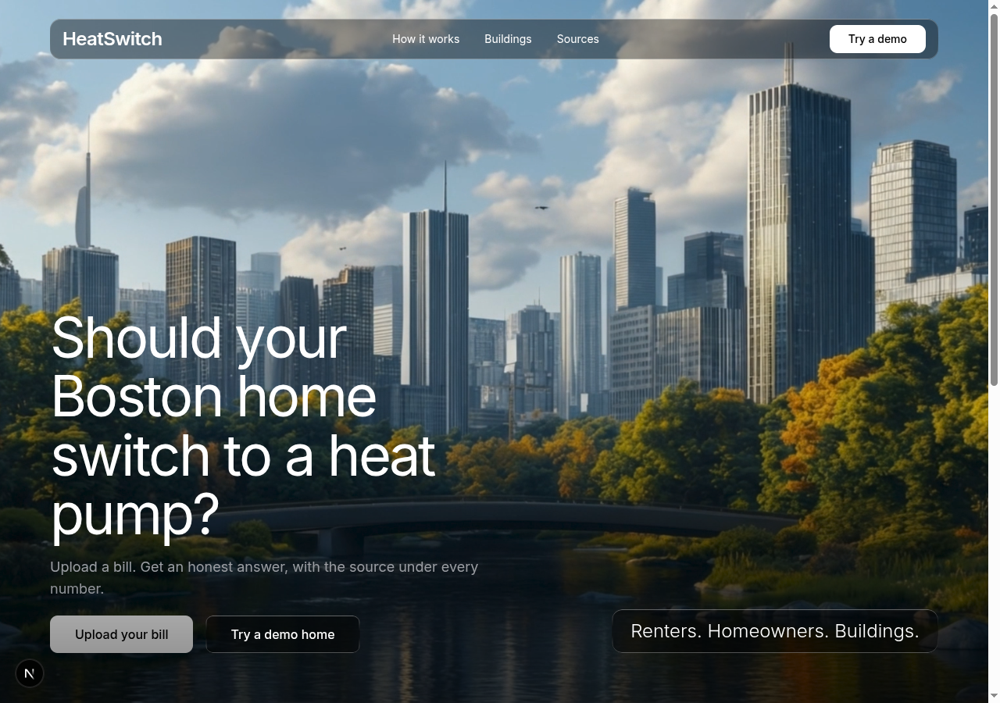

# HeatSwitch

**Find out if a heat pump actually saves you money in Boston.**

**Live app:** https://heatswitch-five.vercel.app
**Demo video:** [VIDEO LINK]
**Built for:** Hackachusetts 2026 · Climatech & Clean Energy · Challenge C2 (cleaner, more affordable buildings)



---

## The problem

I moved to Dorchester two months ago and I've never actually seen my heating bill. My roommate just texts me my split. That's normal here. Most Boston households rent, and the person paying for heat usually isn't the one who decides how the building gets heated.

Heat pumps are supposed to be the fix, and Mass Save covers a big chunk of the install. But whether one actually saves *you* money depends on things nobody explains: what fuel you're on, what you pay per therm or gallon, whether your utility offers the seasonal heat pump rate. Gas in Massachusetts is cheap enough that a heat pump can cost more to run. Oil and electric baseboard are the opposite.

A lot of the tools out there are built by people selling installs, so the answer is always "switch." HeatSwitch is built to tell you when it isn't worth it.

## What it does

- **Upload a bill** (photo or PDF of a gas, electric or oil bill), or enter the numbers yourself, or try one of three demo homes.
- **Every number shows where it came from.** Claude reads the bill and returns each value with the exact line it was read from. Anything it's unsure about turns amber and you confirm it.
- **One verdict:** "Switch now", "Switch when your system needs replacing", or "Not worth it yet", with the yearly dollar difference and an "Act before Dec 31" flag when a 2026 rebate makes it pay off faster.
- **The seasonal heat pump rate.** Eversource, National Grid and Unitil discount winter electricity for heat pump homes. Flip it on and watch the answer change. (The gas demo goes from $403 more per year to $99 saved.)
- **Mass Save rebates by household size and income** (Standard, Enhanced, Income Eligible), what you'd pay after the rebate, payback, and the eligibility checklist.
- **Renters:** turn on "heat included in my rent" and get a summary to send your landlord.
- **Real next step:** Boston zip codes go to the city's free Boston Energy Saver consultation; everyone else to a Mass Save home energy assessment. Equity-zone zips get an informational notice.
- **Buildings tab** for landlords and city staff: Boston multifamily buildings from the city's BERDO 2021 energy data, ranked by heat pump opportunity, filterable by zip.
- **Explanations in six languages:** English, Spanish, Cape Verdean Creole, Chinese, Haitian Creole, Vietnamese.
- **"?" tooltips** on every technical term, and a "How we calculate" panel with every formula and source.

## The one rule: the AI never does the math

```
bill photo/PDF ──► /api/extract (Claude vision) ──► JSON + confidence + evidence per field
                                                         │
                                          Zod validation, user confirms amber fields
                                                         │
                                                         ▼
                         lib/calc.ts + lib/rebates.ts (pure TypeScript, tested)
                                                         │
                         every number on screen ◄────────┤
                                                         ▼
                         /api/explain (Claude) ──► prose only, from the computed numbers
```

Claude reads documents and writes sentences. Every dollar figure, efficiency and payback comes from deterministic functions covered by unit tests, persona tests (hand-worked numbers, ±2%) and fast-check property-based tests, for example:

- turning on the seasonal rate can never raise heat pump cost
- a higher heat pump efficiency never raises its cost
- rebates are never above their cap or the install cost; net cost is never negative
- payback only exists when there are savings
- the building ranking is always a sorted permutation of the input

## Data and sources

| What | Source |
|---|---|
| Building energy data | City of Boston, BERDO 2021 (Analyze Boston), provided as the Hackachusetts C2 dataset |
| Seasonal heat pump rates | Mass.gov, residential electric seasonal heat pump rates |
| Rebates and income limits | Mass Save 2026 |
| Fuel energy content | U.S. EIA |
| System efficiencies | U.S. DOE |
| Heat pump efficiency (COP) | NEEP cold-climate heat pump list |

Every constant in `lib/constants.ts` has its source URL in a comment next to it.

**BERDO cleaning:** rows without site EUI are dropped, only 5-digit `02xxx` zips are kept, exact duplicate rows are removed (70 in the multifamily set), rows with EUI over 300 are kept but flagged "check data", and buildings whose electric and gas shares add up to more than 100% are flagged instead of hidden.

## Run it locally

```bash
git clone https://github.com/aayush24rai/heatswitch.git
cd heatswitch
npm install
cp .env.example .env.local   # then put your Anthropic API key in .env.local
npm run dev                  # http://localhost:3000
npx vitest run               # run the test suite
```

The demo homes and the Buildings tab work without an API key. Bill upload and explanations need `ANTHROPIC_API_KEY`.

To regenerate the buildings data from the CSV: `node scripts/convert-berdo.mjs`

Sample bills for testing upload are in `demo-data/` (fictional, watermarked "SAMPLE – DEMO DATA").

## How we used Kiro

Built solo in Kiro, spec-first. Everything is in the repo:

- **`.kiro/specs/heatswitch/`**: design-first spec (requirements, design, tasks) with requirement traceability. I reviewed the generated spec before writing code and corrected real errors (inverted income tiers, a wrong seasonal-rate model, an invented address field).
- **`.kiro/steering/`**: product, tech, design and workflow rules. The workflow file makes every task end with tests, a log entry and screenshots.
- **Property-based tests** generated from the spec's correctness properties.
- **MCP:** Playwright for desktop and mobile screenshots of every UI task (`docs/kiro/screens/`).
- **Hooks:** [HOOKS]
- **Kiro CLI:** used as a read-only auditor of spec vs code; it caught missing oil input validation.
- **`KIRO_LOG.md`**: the full log of what Kiro did and why it mattered.

## Limitations

- It's a first-pass screen, not a quote. A free Mass Save home energy assessment gives you exact numbers.
- Heat pump efficiency is a single seasonal average (adjustable), not modeled hour by hour from Boston weather.
- Install cost and system size are typical defaults; real quotes vary.
- Bill reading works best on clear photos or PDFs. Low-confidence fields always ask you to confirm.
- BERDO covers large buildings that report to the city, not every home.

## What's next

- Infer heating type from a bill's 12-month usage history (winter vs summer)
- Cross-check extracted usage × rate against bill totals
- Pull bills straight from utility accounts (Green Button)
- Hourly, weather-based heat pump efficiency for Boston
- A "photo of your boiler" helper to estimate system age

## Credits

Hero poster photo by Jacob Licht on Unsplash. Building data: City of Boston open data (BERDO 2021). Bills are never stored.
